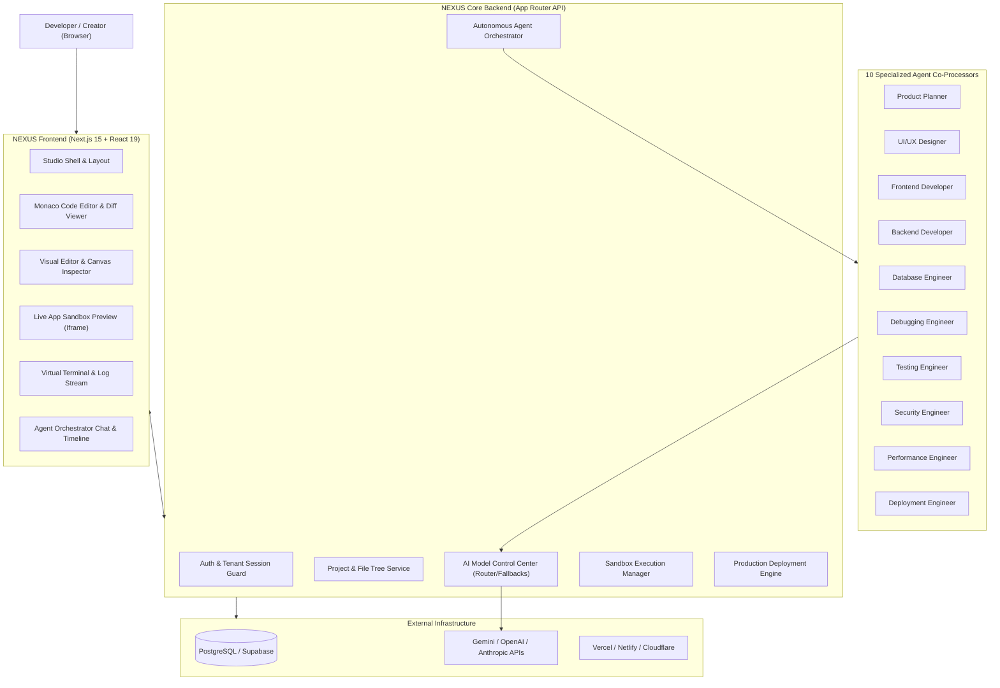

# NEXUS AI — Software Architecture Specification

## 1. Executive Summary

NEXUS AI is an autonomous, multi-agent AI software development platform designed to translate high-level natural language intent into functional, production-ready full-stack applications. The platform mirrors the engineering lifecycle used by senior engineering teams: requirement analysis, architecture, UI design, code implementation, sandbox execution, automated testing, iterative debugging, and production deployment.

---

## 2. System Architecture

---

## 3. Core Subsystems

### 3.1 Autonomous Agent Orchestration Engine
The agent orchestrator controls a deterministic finite state machine (FSM) traversing:
`QUEUED` $\to$ `PLANNING` $\to$ `GENERATING` $\to$ `EXECUTING` $\to$ `TESTING` $\to$ `FIXING` $\to$ `READY` $\to$ `DEPLOYED`

- **Task Graph & Dependency Resolution**: Tasks are arranged in a directed acyclic graph (DAG). For instance, Database migrations and component tokens run prior to route implementation.
- **Conflict Prevention**: Workspace files are checked out with explicit write-leases; agents execute on virtual worktrees before changes are merged and committed.
- **Human-in-the-Loop Escalation**: Irreversible operations (destructive schema changes, secret modifications, production deployments) trigger `NEEDS_APPROVAL`.

### 3.2 AI Model Control Center (Provider Abstraction)
- **Universal Provider Adapter**: Standardized interface supporting:
  - Text generation & continuous streaming (SSE)
  - Tool calling & function execution
  - Structured output with strict JSON schema validation
- **Providers Supported**:
  - Google Gemini (Gemini 2.5 / 1.5 Pro & Flash)
  - OpenAI (GPT-4o, GPT-4o-mini, o3-mini)
  - Anthropic (Claude 3.7 Sonnet, Claude 3.5 Haiku)
  - Custom / Local models (Ollama, vLLM)
- **Security & Key Management**: User API keys are encrypted at rest using AES-256-GCM with server-side envelope encryption. Keys are never transmitted to client browsers.
- **Cost & Quota Tracking**: Token usage is metered per turn with real-time cost estimation and per-tier rate limiting.

### 3.3 Development Environment (IDE & Visual Editor)
- **Monaco Editor Integration**: Full-featured code editor with syntax highlighting for TypeScript, TSX, CSS, JSON, SQL, and Markdown; side-by-side git diff view; multi-tab management.
- **Virtual File System (VFS)**: High-speed in-memory and persistent file tree supporting dynamic creation, updates, deletions, and snapshot checkpoints.
- **Visual Inspector**: Live bidirectional inspect mode. Clicking any element in the preview iframe inspects its source component, allowing direct visual tweaking (copy, typography, colors, padding) with automatic code back-propagation.
- **Screenshot-to-Code**: Multi-modal vision processing pipeline that extracts layout grids, typography hierarchies, and color palettes from user-uploaded images and synthesizes production TSX components.

### 3.4 Isolated Execution & Preview Engine
- **Sandboxed Runtime**: Generates browser-executable bundles using isolated virtual module bundling, WebAssembly/worker shims, and sandboxed iframe environments with restricted origins (`sandbox="allow-scripts allow-forms allow-same-origin allow-modals"`).
- **Virtual Terminal**: Emulates shell execution, streaming package installation, build logs, and console outputs to the developer in real time.
- **Playwright / Synthetic Test Runner**: Executes synthetic user journeys, DOM assertion checks, and responsive screenshot regression tests across Desktop (1440px), Tablet (768px), and Mobile (375px).

### 3.5 Database & Backend Services
- **Schema Synthesis**: Produces PostgreSQL DDL, relational constraints, foreign keys, triggers, and Row Level Security (RLS) policies.
- **REST & Server Action Generation**: Standard CRUD endpoints, filtering, pagination, search, and type-safe schema validation (Zod).
- **Tenant Isolation**: Projects are assigned isolated database namespaces or schemas with strict tenant boundary enforcement.

---

## 4. Security Boundaries

1. **Host Isolation**: Generated untrusted code never executes directly in the main server process.
2. **Credential Privacy**: AI provider keys and service tokens remain strictly server-side.
3. **Storage Security**: Public assets are validated with MIME-type checks and size ceilings; dangerous file types are rejected.
4. **Network Guard**: Sandbox environments have egress controls to prevent server-side request forgery (SSRF).
