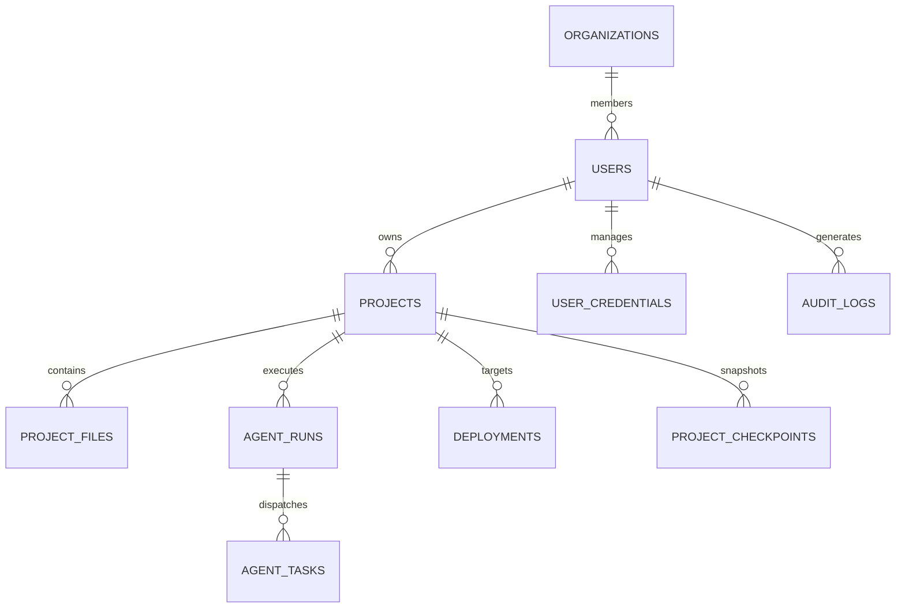

# NEXUS AI — Database Schema Specification

This document details the PostgreSQL schema designed for NEXUS AI, compatible with Supabase and standard PostgreSQL 15+.

---

## 1. Tables Overview



---

## 2. Table Definitions

### 2.1 `nexus_users`
Stores user profile, authentication metadata, and subscription tier.

```sql
CREATE TABLE IF NOT EXISTS public.nexus_users (
    id UUID PRIMARY KEY DEFAULT gen_random_uuid(),
    email TEXT UNIQUE NOT NULL,
    full_name TEXT,
    avatar_url TEXT,
    role TEXT NOT NULL DEFAULT 'user' CHECK (role IN ('user', 'admin', 'developer')),
    tier TEXT NOT NULL DEFAULT 'free' CHECK (tier IN ('free', 'pro', 'team', 'enterprise')),
    monthly_token_quota BIGINT NOT NULL DEFAULT 500000,
    tokens_consumed_this_month BIGINT NOT NULL DEFAULT 0,
    created_at TIMESTAMPTZ NOT NULL DEFAULT timezone('utc', now()),
    updated_at TIMESTAMPTZ NOT NULL DEFAULT timezone('utc', now())
);
```

### 2.2 `nexus_projects`
Stores project metadata, settings, active template, and current generation state.

```sql
CREATE TABLE IF NOT EXISTS public.nexus_projects (
    id UUID PRIMARY KEY DEFAULT gen_random_uuid(),
    user_id UUID NOT NULL REFERENCES public.nexus_users(id) ON DELETE CASCADE,
    name TEXT NOT NULL,
    slug TEXT NOT NULL,
    description TEXT,
    template TEXT NOT NULL DEFAULT 'nextjs-saas',
    current_status TEXT NOT NULL DEFAULT 'READY' CHECK (
        current_status IN ('QUEUED', 'PLANNING', 'GENERATING', 'EXECUTING', 'TESTING', 'FIXING', 'READY', 'DEPLOYED', 'FAILED', 'CANCELLED', 'NEEDS_APPROVAL')
    ),
    framework TEXT NOT NULL DEFAULT 'nextjs',
    thumbnail_url TEXT,
    is_archived BOOLEAN NOT NULL DEFAULT false,
    settings JSONB NOT NULL DEFAULT '{"theme": "dark", "autoFix": true, "strictTesting": true}',
    created_at TIMESTAMPTZ NOT NULL DEFAULT timezone('utc', now()),
    updated_at TIMESTAMPTZ NOT NULL DEFAULT timezone('utc', now())
);
CREATE INDEX IF NOT EXISTS idx_nexus_projects_user_id ON public.nexus_projects(user_id);
```

### 2.3 `nexus_project_files`
Represents the virtual filesystem of each project.

```sql
CREATE TABLE IF NOT EXISTS public.nexus_project_files (
    id UUID PRIMARY KEY DEFAULT gen_random_uuid(),
    project_id UUID NOT NULL REFERENCES public.nexus_projects(id) ON DELETE CASCADE,
    path TEXT NOT NULL,
    name TEXT NOT NULL,
    content TEXT NOT NULL,
    is_directory BOOLEAN NOT NULL DEFAULT false,
    language TEXT NOT NULL DEFAULT 'typescript',
    size_bytes INTEGER NOT NULL DEFAULT 0,
    version INTEGER NOT NULL DEFAULT 1,
    last_modified_by TEXT NOT NULL DEFAULT 'agent:frontend',
    created_at TIMESTAMPTZ NOT NULL DEFAULT timezone('utc', now()),
    updated_at TIMESTAMPTZ NOT NULL DEFAULT timezone('utc', now()),
    UNIQUE(project_id, path)
);
CREATE INDEX IF NOT EXISTS idx_nexus_project_files_proj ON public.nexus_project_files(project_id);
```

### 2.4 `nexus_agent_runs`
Tracks autonomous orchestration sessions and execution prompts.

```sql
CREATE TABLE IF NOT EXISTS public.nexus_agent_runs (
    id UUID PRIMARY KEY DEFAULT gen_random_uuid(),
    project_id UUID NOT NULL REFERENCES public.nexus_projects(id) ON DELETE CASCADE,
    user_id UUID NOT NULL REFERENCES public.nexus_users(id),
    prompt TEXT NOT NULL,
    status TEXT NOT NULL DEFAULT 'QUEUED' CHECK (
        status IN ('QUEUED', 'PLANNING', 'GENERATING', 'EXECUTING', 'TESTING', 'FIXING', 'READY', 'DEPLOYED', 'FAILED', 'CANCELLED', 'NEEDS_APPROVAL')
    ),
    plan JSONB,
    tokens_used INTEGER NOT NULL DEFAULT 0,
    cost_usd NUMERIC(10, 6) NOT NULL DEFAULT 0,
    error_summary TEXT,
    started_at TIMESTAMPTZ NOT NULL DEFAULT timezone('utc', now()),
    completed_at TIMESTAMPTZ
);
```

### 2.5 `nexus_agent_tasks`
Discrete tasks assigned to individual specialized agents.

```sql
CREATE TABLE IF NOT EXISTS public.nexus_agent_tasks (
    id UUID PRIMARY KEY DEFAULT gen_random_uuid(),
    run_id UUID NOT NULL REFERENCES public.nexus_agent_runs(id) ON DELETE CASCADE,
    agent_role TEXT NOT NULL CHECK (
        agent_role IN ('planner', 'designer', 'frontend', 'backend', 'database', 'debugger', 'tester', 'security', 'performance', 'deployment')
    ),
    title TEXT NOT NULL,
    description TEXT,
    status TEXT NOT NULL DEFAULT 'pending' CHECK (status IN ('pending', 'running', 'completed', 'failed', 'blocked')),
    output JSONB,
    started_at TIMESTAMPTZ,
    finished_at TIMESTAMPTZ
);
```

### 2.6 `nexus_credentials`
Stores encrypted provider credentials for users (AES-256-GCM).

```sql
CREATE TABLE IF NOT EXISTS public.nexus_credentials (
    id UUID PRIMARY KEY DEFAULT gen_random_uuid(),
    user_id UUID NOT NULL REFERENCES public.nexus_users(id) ON DELETE CASCADE,
    provider TEXT NOT NULL CHECK (provider IN ('gemini', 'openai', 'anthropic', 'custom')),
    encrypted_key TEXT NOT NULL,
    iv TEXT NOT NULL,
    tag TEXT NOT NULL,
    label TEXT,
    is_active BOOLEAN NOT NULL DEFAULT true,
    last_verified_at TIMESTAMPTZ,
    created_at TIMESTAMPTZ NOT NULL DEFAULT timezone('utc', now()),
    UNIQUE(user_id, provider)
);
```

### 2.7 `nexus_deployments`
Deployment history and provider status.

```sql
CREATE TABLE IF NOT EXISTS public.nexus_deployments (
    id UUID PRIMARY KEY DEFAULT gen_random_uuid(),
    project_id UUID NOT NULL REFERENCES public.nexus_projects(id) ON DELETE CASCADE,
    target_provider TEXT NOT NULL CHECK (target_provider IN ('supabase', 'vercel', 'netlify', 'zip', 'webhook')),
    status TEXT NOT NULL DEFAULT 'pending' CHECK (status IN ('pending', 'building', 'live', 'failed', 'cancelled')),
    deployment_url TEXT,
    build_logs TEXT,
    commit_hash TEXT,
    created_at TIMESTAMPTZ NOT NULL DEFAULT timezone('utc', now())
);
```

### 2.8 `nexus_audit_logs`
Security, compliance, and user action audit trail.

```sql
CREATE TABLE IF NOT EXISTS public.nexus_audit_logs (
    id UUID PRIMARY KEY DEFAULT gen_random_uuid(),
    user_id UUID REFERENCES public.nexus_users(id) ON DELETE SET NULL,
    project_id UUID REFERENCES public.nexus_projects(id) ON DELETE SET NULL,
    action TEXT NOT NULL,
    metadata JSONB NOT NULL DEFAULT '{}',
    ip_address TEXT,
    created_at TIMESTAMPTZ NOT NULL DEFAULT timezone('utc', now())
);
```

---

## 3. Row Level Security (RLS)

All tables enforce PostgreSQL Row Level Security:

```sql
ALTER TABLE public.nexus_users ENABLE ROW LEVEL SECURITY;
ALTER TABLE public.nexus_projects ENABLE ROW LEVEL SECURITY;
ALTER TABLE public.nexus_project_files ENABLE ROW LEVEL SECURITY;
ALTER TABLE public.nexus_agent_runs ENABLE ROW LEVEL SECURITY;
ALTER TABLE public.nexus_credentials ENABLE ROW LEVEL SECURITY;
ALTER TABLE public.nexus_deployments ENABLE ROW LEVEL SECURITY;
ALTER TABLE public.nexus_audit_logs ENABLE ROW LEVEL SECURITY;

-- Project access policy: Users can only view/mutate their own projects
CREATE POLICY nexus_projects_owner_policy ON public.nexus_projects
    FOR ALL
    USING (auth.uid() = user_id)
    WITH CHECK (auth.uid() = user_id);

-- Files access policy: Users can only access files of projects they own
CREATE POLICY nexus_files_owner_policy ON public.nexus_project_files
    FOR ALL
    USING (
        EXISTS (
            SELECT 1 FROM public.nexus_projects
            WHERE public.nexus_projects.id = nexus_project_files.project_id
            AND public.nexus_projects.user_id = auth.uid()
        )
    );
```
