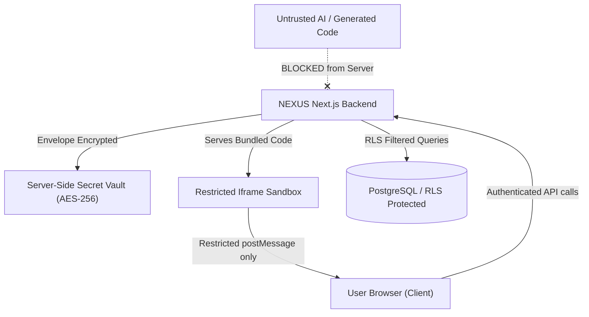

# NEXUS AI — Security Policy and Threat Model

This document outlines the security architecture, threat model, mitigation strategies, and defensive boundaries implemented across the NEXUS AI platform.

---

## 1. Threat Model & Security Boundaries

---

## 2. Security Principles

### 2.1 Host Isolation & Untrusted Code Execution
- **Strict Prohibition**: Generated code is **never** executed natively inside the main Node.js application server process.
- **Client-Side Isolated Sandbox**: Preview execution is conducted inside isolated `<iframe>` elements with restricted HTML5 sandbox permissions:
  `sandbox="allow-scripts allow-forms allow-same-origin allow-modals"`
- Cross-origin isolation headers (`Cross-Origin-Opener-Policy: same-origin` and `Cross-Origin-Embedder-Policy: require-corp`) protect against speculative side-channel attacks.

### 2.2 Server-Side Secret Management & BYOK
- **No Client Exposure**: API keys (Gemini, OpenAI, Anthropic, Supabase service roles) are strictly kept on the server. Client-facing components never receive plaintext API secrets.
- **Envelope Encryption**: User-supplied Bring-Your-Own-Key (BYOK) credentials stored in the database are encrypted using AES-256-GCM with unique initialization vectors (IV) and authentication tags.
- Keys are decrypted only transiently in memory when dispatching an AI generation request.

### 2.3 Row Level Security (RLS) & Multi-Tenancy
- PostgreSQL Row Level Security (RLS) is enabled on all tables.
- All file reads, project queries, agent runs, and deployment operations enforce tenant ownership:
  `auth.uid() = user_id`
- Cross-tenant data exfiltration is mathematically prevented at the database kernel level.

### 2.4 Server-Side Request Forgery (SSRF) Prevention
- Outbound network requests made by the agent engine or deployment adapters are validated against an IP blocklist (disallowing private RFC 1918 subnets, `127.0.0.1`, `169.254.169.254`, and internal hostnames).

### 2.5 Input Sanitization & Content Security Policy (CSP)
- Prompts, filenames, and project parameters are sanitized to prevent path traversal attacks (`../`, `\` normalization).
- Strict Content Security Policy headers restrict script execution and style sources.

### 2.6 Audit Logging
- Every destructive action (project deletion, file overwrite, key update, deployment trigger) writes an immutable record to `nexus_audit_logs`.
